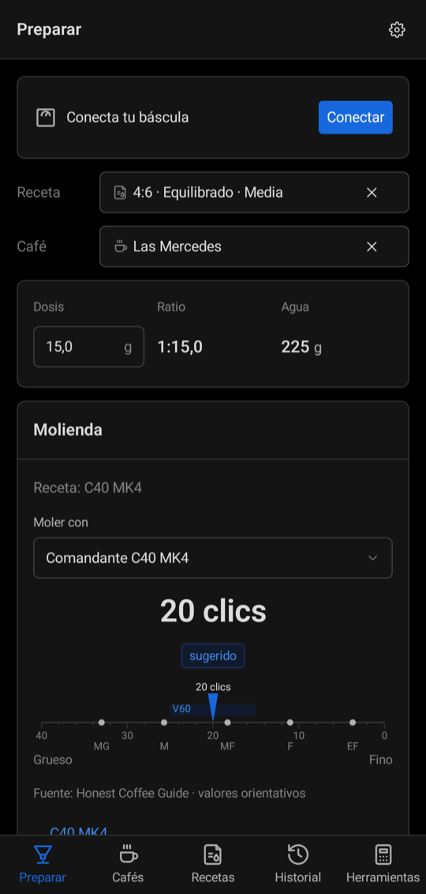
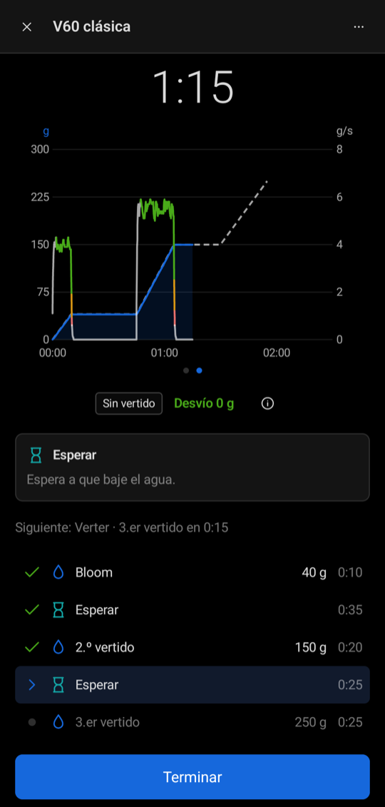
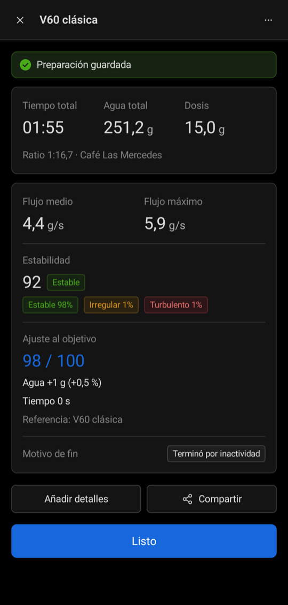
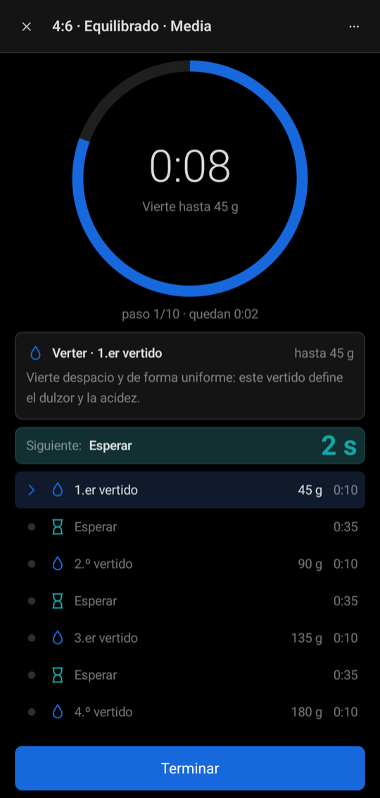
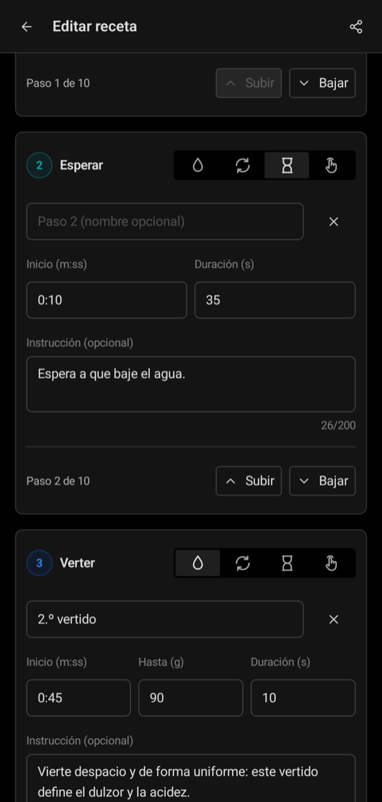
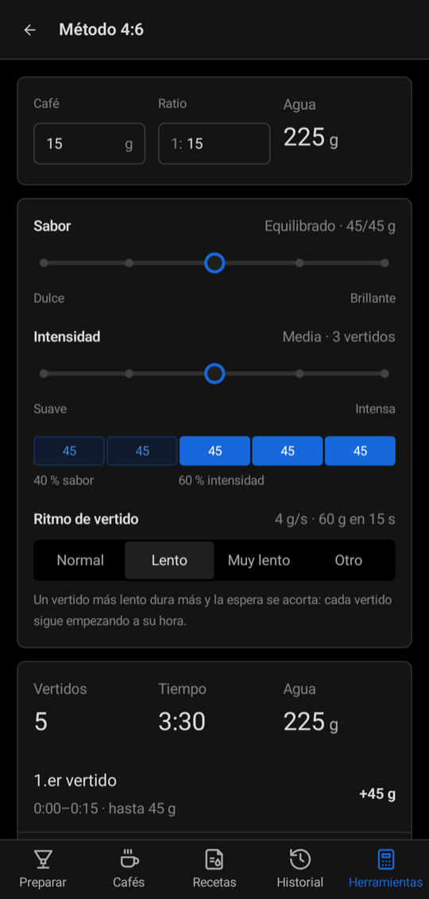
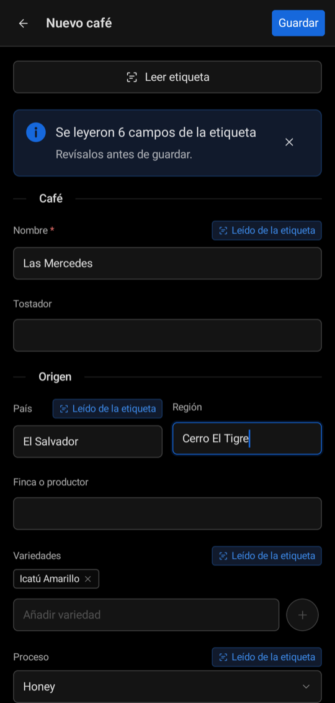
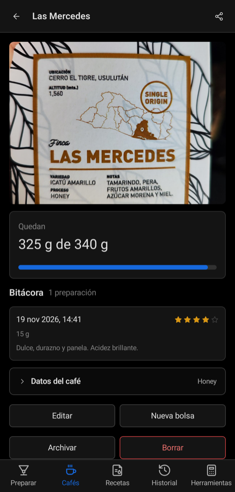

<div align="center">


# Pourline

**Café de filtro, vertido a vertido.**

App Android para preparar café de filtro con las básculas TIMEMORE Black Mirror por Bluetooth, o sin báscula.

[](LICENSE)


</div>

---

## Capturas

<table>
  <tr>
    <td align="center"><br><sub><b>Preparar</b><br>Receta, café, dosis y molienda sugerida para tu molino</sub></td>
    <td align="center"><br><sub><b>Sesión con báscula</b><br>Peso y flujo en tiempo real frente a la curva objetivo</sub></td>
    <td align="center"><br><sub><b>Resumen</b><br>Flujo, estabilidad del chorro y ajuste a la receta</sub></td>
    <td align="center"><br><sub><b>Sin báscula</b><br>Temporizador guiado paso a paso</sub></td>
  </tr>
  <tr>
    <td align="center"><br><sub><b>Editor de recetas</b><br>Pasos de Verter, Remover, Esperar y Acción</sub></td>
    <td align="center"><br><sub><b>Método 4:6</b><br>Sabor, intensidad y ritmo de vertido</sub></td>
    <td align="center"><br><sub><b>Leer etiqueta</b><br>Los datos del café salen de una foto de la bolsa</sub></td>
    <td align="center"><br><sub><b>Ficha del café</b><br>Lo que queda en la bolsa y la bitácora de cata</sub></td>
  </tr>
</table>

## Qué hace

### Preparar
- **Recetas paso a paso** con cuatro tipos de paso: Verter, Remover, Esperar y Acción. Cada tipo tiene su color, y el cambio de paso se avisa con sonido y vibración.
- **Cuenta atrás de inicio** y tiempo total de la receta a la vista.
- **Gráfica de vertido en tiempo real**: peso, flujo y regularidad del chorro, comparados con la curva objetivo de la receta.
- **Con o sin báscula**: sin báscula, la app te guía con el temporizador de cada paso.

### Registrar
- **Historial** de cada preparación, con su gráfica, notas de cata y comparación con preparaciones anteriores.
- **Catálogo de cafés**: tostador, origen, proceso y fecha de tueste. Los datos se leen de la etiqueta con la cámara mediante OCR en el propio dispositivo, sin conexión.
- **Molinos** con conversión de molienda entre ellos a partir de pares de calibración.

### Herramientas
- **Calculadora de ratio** café/agua.
- **Generador del método 4:6** (Tetsu Kasuya): elige sabor, intensidad y ritmo de vertido, y guárdalo como receta.
- **Compartir recetas** como imagen con un código QR que otra instalación de Pourline puede importar.

### Y además
- Modos **Básico** y **Experto** según cuánto detalle quieras ver.
- **Recorrido guiado** la primera vez que abres la app.
- Disponible en **español** e **inglés**.

## Básculas compatibles

| Modelo | Estado |
|---|---|
| TIMEMORE Black Mirror **DOT** | Objetivo principal |
| TIMEMORE Black Mirror **Basic 3** | Mismo protocolo, sin probar con hardware |
| TIMEMORE Black Mirror **ESPRO** | Mismo protocolo, sin probar con hardware |

¿No tienes báscula? Hay una **báscula simulada** para probar la app de punta a punta.

El protocolo BLE está documentado en [`docs/PROTOCOL.md`](docs/PROTOCOL.md), independiente del lenguaje, para que cualquiera pueda implementar su propio cliente (iOS, Web Bluetooth, Python, ESP32…).

## Stack

| Área | Tecnología |
|---|---|
| Lenguaje | Kotlin 2.3 |
| UI | Jetpack Compose + Material 3 |
| Navegación | Navigation 3 |
| Persistencia | Room |
| Serialización | kotlinx.serialization |
| OCR | ML Kit Text Recognition (modelo incluido en el APK) |
| QR | ZXing (generar) + Google Code Scanner (leer) |
| Build | Android Gradle Plugin 9, R8 en release |

### Módulos

```
Pourline
├── protocol/   Protocolo BLE en Kotlin/JVM puro: tramas, CRC-16/MODBUS, comandos y parser
└── app/        App Android: conexión BLE, UI, recetas, historial, cafés y molinos
```

`:protocol` no depende de Android, así que se puede probar con tests JVM y reutilizar en otros proyectos.

## Compilar

**Requisitos:** JDK 17 y Android SDK con la plataforma 37 (Android Studio reciente).

```bash
git clone git@github.com:c3rberuss/pourline.git
cd pourline

# APK de debug
./gradlew :app:assembleDebug

# APK de release (reducido y ofuscado con R8)
./gradlew :app:assembleRelease
```

#### Firma de release

El release se firma con tu propio keystore. Crea `keystore.properties` en la raíz del proyecto (está en `.gitignore`):

```properties
storeFile=/ruta/absoluta/a/pourline-release.jks
storePassword=…
keyAlias=…
keyPassword=…
```

En CI se usan las variables de entorno `POURLINE_KEYSTORE_FILE`, `POURLINE_KEYSTORE_PASSWORD`, `POURLINE_KEY_ALIAS` y `POURLINE_KEY_PASSWORD`, que tienen prioridad sobre el archivo. Sin credenciales, `assembleRelease` genera `app-release-unsigned.apk`, que no se puede instalar.

#### Publicar una versión

Al subir un tag `vX.Y.Z`, el workflow `.github/workflows/release.yml` compila el APK firmado y lo publica en GitHub Releases como `pourline-X.Y.Z.apk`. La versión sale del tag: `versionName = X.Y.Z` y `versionCode = X·1000000 + Y·1000 + Z`.

```bash
git tag v1.0.0
git push origin v1.0.0
```

Necesita estos secretos en el repositorio: `POURLINE_KEYSTORE_BASE64` (el keystore en base64), `POURLINE_KEYSTORE_PASSWORD`, `POURLINE_KEY_ALIAS` y `POURLINE_KEY_PASSWORD`.

### Tests

```bash
./gradlew :protocol:test                  # protocolo
./gradlew :app:testDebugUnitTest          # tests JVM de la app
./gradlew :app:connectedDebugAndroidTest  # tests instrumentados (requiere dispositivo o emulador)
```

## Documentación

- [`docs/PROTOCOL.md`](docs/PROTOCOL.md): protocolo BLE de las básculas Black Mirror.
- [`docs/API.md`](docs/API.md): cómo usar las clases Kotlin para conectarse, leer y controlar la báscula.
- [`docs/specs/`](docs/specs): especificaciones y planes de cada funcionalidad.

## Licencia

Pourline es software libre bajo la [GNU General Public License v3.0](LICENSE).

Según el término adicional de la sección 7(b) (ver [`NOTICE`](NOTICE)), cualquier obra derivada debe conservar esta atribución en su código y en los avisos legales de su interfaz (por ejemplo, una pantalla "Acerca de"):

> Based on Pourline by Josué Amaya — https://github.com/c3rberuss/pourline

---

<sub>Pourline es un proyecto independiente. No está afiliado, respaldado ni patrocinado por TIMEMORE. TIMEMORE, Black Mirror y DOT son marcas de sus respectivos propietarios.</sub>
