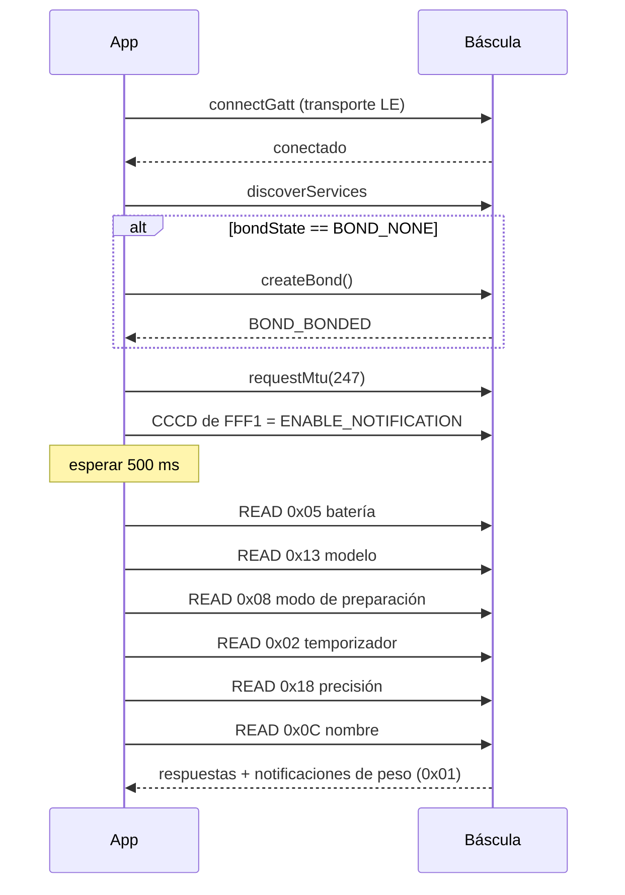

# Protocolo BLE de las básculas TIMEMORE Black Mirror

Especificación del protocolo de comunicación entre la app y las básculas TIMEMORE Black Mirror
**DOT**, **Basic 3** y **ESPRO** (el que la app oficial llama internamente "Ble2025").

No depende de ningún lenguaje: con este documento se puede implementar un cliente en Android, iOS,
Web Bluetooth, Python (`bleak`), ESP32, etc. La implementación de referencia está en el módulo
[`protocol`](../protocol/src/main/kotlin/dev/josueamaya/pourline/protocol); su uso se explica en [API.md](API.md).

## Contenido

1. [Origen y fiabilidad](#1-origen-y-fiabilidad)
2. [Modelos compatibles](#2-modelos-compatibles)
3. [Descubrimiento (anuncio BLE)](#3-descubrimiento-anuncio-ble)
4. [Servicio GATT](#4-servicio-gatt)
5. [Secuencia de conexión](#5-secuencia-de-conexión)
6. [Formato de trama](#6-formato-de-trama)
7. [CRC-16/MODBUS](#7-crc-16modbus)
8. [Tipos de operación](#8-tipos-de-operación)
9. [Tabla de comandos](#9-tabla-de-comandos)
10. [Detalle de cada comando](#10-detalle-de-cada-comando)
11. [Recepción y separación de tramas](#11-recepción-y-separación-de-tramas)
12. [Ejemplos completos](#12-ejemplos-completos)
13. [Pendiente de verificar](#13-pendiente-de-verificar)
14. [Cómo verificar con hardware](#14-cómo-verificar-con-hardware)

---

## 1. Origen y fiabilidad

El protocolo se obtuvo por ingeniería inversa de la app oficial `com.timemore.blackmirror`
**v2.6.0** (versionCode 132), con el único fin de lograr interoperabilidad con una báscula propia.
Clases de origen (nombres de jadx):

| Clase original | Contenido |
|---|---|
| `ble.BleService$15.onCharacteristicChanged` (`Scale2025DataParser`) | Separación de tramas y parser de respuestas |
| `ble.c` (`Ble2025DeviceUtils`) | Construcción de tramas, CRC y envío de comandos |
| `ble.BleService` | Secuencia de conexión, emparejamiento, MTU y handshake |
| `c5.a`, `ble.model.ScaleModel` | Anuncio BLE e identificación del modelo |
| `ble.BrewModeStageBean` | Modos y etapas de preparación |

A lo largo del documento cada dato lleva su nivel de confianza:

| Nivel | Significado |
|---|---|
| **Código** | Se ve explícitamente en el código de la app oficial |
| **Inferido** | Se deduce del uso que hace la app, pero no aparece explícito |
| **Desconocido** | Se sabe que existe, pero no se conoce su significado |

> Nada de esto se ha probado todavía con una báscula física. Ver [§13](#13-pendiente-de-verificar).

> La clase `Commands$Scales` de la app oficial pertenece al protocolo **antiguo** (báscula doble
> TES08) y usa otros números de comando. **No** aplica a este protocolo.

## 2. Modelos compatibles

| Modelo | Nombre de firmware (cmd `0x13`) | Código en el anuncio | `scaleType` interno | Valida CRC* |
|---|---|---|---|---|
| Black Mirror **DOT** | `TES017` | `1` | `1` | No |
| Black Mirror **Basic 3** | `TES016` | `2` | `3` | Sí |
| Black Mirror **ESPRO** | `TES015` | `3` | `2` | Sí |
| Black Mirror doble (antigua) | `TES08` | — | `0` | Otro protocolo |

\* La app oficial solo comprueba el CRC de las tramas recibidas en Basic 3 y ESPRO (`isBasic3FamilyScale() && !isDotScale()`).
Con la DOT no lo comprueba, lo que sugiere que su firmware puede enviar un CRC incorrecto.
**Recomendación:** comprobar el CRC, registrar los fallos y no descartar la trama. (Confianza: Código)

## 3. Descubrimiento (anuncio BLE)

La báscula publica **manufacturer specific data** con *company ID* `0xFFFF`.
Android (`ScanRecord.getManufacturerSpecificData(0xFFFF)`) y la mayoría de stacks devuelven el payload
**sin** los 2 bytes del company ID:

| Byte | Campo | Valores |
|---|---|---|
| 0 | Tipo de anuncio | `1` o `2` (con cualquier otro valor, el dispositivo no es una báscula compatible) |
| 1 | Código de modelo | `1` DOT · `2` Basic 3 · `3` ESPRO |
| 2 | Versión de protocolo (opcional) | Desconocido |

(Confianza: Código.) La app oficial también muestra dispositivos que no tienen estos datos pero sí
un nombre anunciado. Como respaldo de la identificación se puede usar el servicio `FFF0` o que el
nombre contenga `TIMEMORE`.

## 4. Servicio GATT

| Elemento | UUID | Propiedad | Uso |
|---|---|---|---|
| Servicio | `0000fff0-0000-1000-8000-00805f9b34fb` | — | Servicio principal |
| Notify | `0000fff1-0000-1000-8000-00805f9b34fb` | Notify | Báscula → app |
| Write | `0000fff2-0000-1000-8000-00805f9b34fb` | Write | App → báscula |
| CCCD | `00002902-0000-1000-8000-00805f9b34fb` | — | Descriptor para activar las notificaciones de `FFF1` |

La app oficial también conoce el *Weight Scale Service* estándar (`0x181D`, característica `0x2A9D`)
y el *Device Information Service* (`0x180A`), pero el tráfico del protocolo 2025 va por `FFF0`.

## 5. Secuencia de conexión

Orden que sigue `BleService` (Confianza: Código):



Notas:

- La conexión se considera lista cuando llega una respuesta válida al **modelo** (`0x13`).
  Si el modelo es inválido (`-1`), la app oficial no entra en estado *Ready*.
- Si el MTU falla, se puede seguir con el MTU por defecto (23): todas las tramas habituales caben en 20 bytes.
  La excepción es un nombre largo con `0x0C`.
- Las operaciones GATT deben ejecutarse de **una en una** (limitación de Android).
- La app oficial además lee la unidad (`0x06`) y el firmware (`0x10`) desde otras pantallas.

## 6. Formato de trama

Todas las tramas, en ambos sentidos, tienen este formato. Los enteros multibyte van en **big-endian**.

```
 0      1      2      3      4      5      6 … 6+N-1     6+N    6+N+1
┌──────┬──────┬──────┬──────┬─────────────┬───────────┬─────────────┐
│ 0xA5 │ 0x5A │  op  │ cmd  │ len (u16 BE)│ payload   │ CRC (u16 BE)│
└──────┴──────┴──────┴──────┴─────────────┴───────────┴─────────────┘
```

| Offset | Tamaño | Campo | Descripción |
|---|---|---|---|
| 0 | 2 | Cabecera | Siempre `A5 5A` |
| 2 | 1 | `op` | Tipo de operación ([§8](#8-tipos-de-operación)) |
| 3 | 1 | `cmd` | Comando ([§9](#9-tabla-de-comandos)) |
| 4 | 2 | `len` | Longitud del payload, N (0–1024) |
| 6 | N | `payload` | Datos del comando |
| 6+N | 2 | `crc` | CRC-16/MODBUS de los bytes `0 … 6+N-1` |

Tamaño total: `N + 8` bytes. Una trama con `len > 1024` se considera inválida.

## 7. CRC-16/MODBUS

| Parámetro | Valor |
|---|---|
| Polinomio | `0x8005` (reflejado: `0xA001`) |
| Valor inicial | `0xFFFF` |
| Entrada/salida reflejadas | Sí |
| XOR final | `0x0000` |
| Valor de comprobación (`"123456789"`) | `0x4B37` |
| Orden en la trama | Big-endian: byte alto primero |

```python
def crc16_modbus(data: bytes) -> int:
    crc = 0xFFFF
    for b in data:
        crc ^= b
        for _ in range(8):
            crc = (crc >> 1) ^ 0xA001 if crc & 1 else crc >> 1
    return crc
```

## 8. Tipos de operación

| `op` | Sentido | Significado | Payload | Confianza |
|---|---|---|---|---|
| `0x02` | App → báscula | **Lectura**: pide el valor de `cmd` | Vacío (`len = 0`) | Código |
| `0x02` | Báscula → app | Respuesta a una lectura | Según el comando | Inferido |
| `0x03` | App → báscula | **Escritura** de un valor | Según el comando | Código |
| `0x03` | Báscula → app | **ACK** de la escritura | 1 byte: `1` = OK, otro valor = error | Código |
| `0x01` | Báscula → app | Notificación espontánea (peso, cambios hechos con los botones) | Según el comando | **Inferido** |

El parser de la app oficial trata `op = 0x03` como ACK. Cualquier otro valor de `op` lo interpreta
según `cmd`, sin distinguir entre respuesta y notificación. Un cliente robusto debe hacer lo mismo
y no depender del valor exacto de `op` en las tramas recibidas.

## 9. Tabla de comandos

L = lectura (`op 0x02`) · E = escritura (`op 0x03`) · N = la báscula lo notifica.

| `cmd` | Nombre | L | E | N | Modelos | Resumen |
|---|---|---|---|---|---|---|
| `0x01` | Peso | | | ✓ | Todos | Peso, flujo, tiempo |
| `0x02` | Temporizador | ✓ | ✓ | ✓ | Todos | Iniciar, pausar, reiniciar |
| `0x03` | Ratio café:agua | ✓ | | ✓ | Basic 3 / DOT | u16 |
| `0x04` | Control de ratio/dosis | ✓ | ✓ | ✓ | Basic 3 / DOT | Dosis objetivo |
| `0x05` | Batería | ✓ | | ✓ | Todos | Porcentaje |
| `0x06` | Unidad de peso | ✓ | ✓ | ✓ | Todos | g / oz |
| `0x07` | Sonido de botones | ✓ | ✓ | ✓ | Todos | On/off |
| `0x08` | Modo y etapa | ✓ | ✓ | ✓ | Todos | Estándar, pour-over, espresso |
| `0x09` | Tiempo de preinfusión | | | ✓ | ESPRO | Etapa + segundos |
| `0x0B` | Apagado | | | ✓ | Todos | Aviso de apagado |
| `0x0C` | Nombre | ✓ | ✓ | | Todos | Texto UTF-8 |
| `0x0D` | Tara | | ✓ | ✓ | Todos | Poner a cero |
| `0x10` | Versión de firmware | ✓ | | | Todos | Texto |
| `0x12` | Número de serie | ✓ | | | Todos | Texto |
| `0x13` | Modelo | ✓ | | | Todos | `TES0xx` |
| `0x16` | Tiempo de espera | ✓ | | ✓ | Todos | 2 × u16 |
| `0x17` | Sensibilidad | ✓ | ✓ | ✓ | Todos | Nivel |
| `0x18` | Precisión | ✓ | ✓ | ✓ | Todos | `1` o `10` |
| `0x19` | Restablecer de fábrica | | ? | ✓ | Todos | Código de resultado |
| `0x1A` | Olvidar dispositivo | | ✓ | ✓ | Todos | Desvincular |
| `0x25` | Brillo de pantalla | ✓ | | ✓ | ESPRO | 0–100 |

`0x1C` aparece en la app oficial como comando "terminal" junto a `0x0B`, `0x19` y `0x1A`, pero no
se usa en ningún sitio (Desconocido).

## 10. Detalle de cada comando

### `0x01` Peso (notificación)

La báscula lo envía de forma continua mientras está conectada.

| Offset | Tipo | Campo | Escala |
|---|---|---|---|
| 0 | **i32** BE (con signo) | Peso | g ×10 · oz ×100 |
| 4 | **i16** BE (con signo) | Flujo | (g ×10 · oz ×100) por segundo |
| 6 | u16 BE | Tiempo del temporizador | segundos |
| 8 | u8 (opcional) | Fuera de rango | `1` = sobrepeso o peso negativo excesivo |

- La escala depende de la **unidad actual** de la báscula ([`0x06`](#0x06-unidad-de-peso)):
  `peso = valor / 10` en gramos y `valor / 100` en onzas. Un cliente debe recordar la última
  unidad recibida (Confianza: Código).
- El peso y el flujo pueden ser **negativos**, por ejemplo al retirar la taza tras hacer tara.
- Un payload de menos de 8 bytes se descarta.

### `0x02` Temporizador

| Código | Estado / acción |
|---|---|
| `1` | En marcha / **iniciar** |
| `2` | En pausa / **pausar** |
| `3` | Reiniciado / **reiniciar** |

- Escritura: `[código]`. Ejemplo: iniciar = `A5 5A 03 02 00 01 01 18 67`.
- Lectura / notificación: `[código]`.
- La app oficial vuelve a leer `0x02` tras cada escritura para sincronizar el estado.

### `0x03` Ratio café:agua

- Respuesta: `u16` (exactamente 2 bytes). La escala no está confirmada; probablemente ratio ×10
  (`150` = 1:15) (Inferido).

### `0x04` Control de ratio / dosis

| Escritura | Payload | Significado (Inferido) |
|---|---|---|
| Abrir | `FF 00 00 00 00` | Activar el modo ratio |
| Cerrar | `01 00 00 00 00` | Desactivar el modo ratio |
| Fijar dosis | `04` + `i32(dosis_g × 10)` | Dosis de café objetivo |
| Borrar dosis | `02` + `i32(0)` | La app la envía cuando la dosis es ≤ 0 |
| — | `03` | Aparece en la pantalla de datos de preparación. Desconocido |

- Respuesta: exactamente 5 bytes, `[modo u8][valor i32]`. La app oficial lo considera "cerrado"
  cuando `modo == 1 && valor == 0`.

### `0x05` Batería

| Offset | Campo |
|---|---|
| 0 | Estado (Desconocido; probablemente si está cargando) |
| 1 | Porcentaje 0–100 (la app oficial lo limita a ese rango) |

### `0x06` Unidad de peso

- `0` = gramos · `1` = onzas. Escritura: `[código]`. Lectura / notificación: `[código]`.
- Al cambiar la unidad, cambia la escala de los valores de [`0x01`](#0x01-peso-notificación).

### `0x07` Sonido de botones

- `0` = apagado · `1` = encendido. Escritura y lectura: `[valor]`.

### `0x08` Modo y etapa de preparación

- Escritura: `[modo, etapa]`. Respuesta: `[modo, etapa, (i32 parámetro)]`. El parámetro solo
  viene si `len ≥ 6` y su significado es Desconocido.

| Modo | Etapa | Descripción (traducida de la app oficial) |
|---|---|---|
| `1` Estándar | `0` | Modo estándar |
| `2` Pour-over | `0` | Estado inicial |
| | `1` | Antes de preparar: pesando la dosis de café |
| | `2` | Esperando; tras una cuenta atrás de 3 s muestra `--`; al detectar peso pasa a la etapa 3 |
| | `3` | Preparando (primeros 40 s) |
| | `4` | Pasados 40 s: esperando que se retire la taza o se termine manualmente |
| | `5` | Taza retirada: pausa; peso y tiempo parpadean a 1 Hz |
| `3` Espresso | `0` | Estado inicial |
| | `1` | Esperando las primeras gotas |
| | `2` | Hasta 12 s: tiempo en marcha, flujo y peso normales |
| | `3` | Esperando que deje de caer líquido |
| | `4` | Basic 3 / DOT: resultado parpadeando · ESPRO: esperando que deje de caer |
| | `5` | ESPRO: peso y tiempo parpadeando a 1 Hz |

Escrituras que usa la app oficial: `[2, 0]` (iniciar pour-over), `[2, 1]`, `[2, 2]` y `[3, 1]` (iniciar espresso).

### `0x09` Tiempo de preinfusión (solo ESPRO)

- `[etapa u8 (1–3), segundos u16 (≤ 599)]`. Fuera de esos rangos se ignora.

### `0x0B` Apagado

- Notificación `[código]` cuando la báscula se apaga.

### `0x0C` Nombre del dispositivo

- Lectura: texto UTF-8. Escritura: el nuevo nombre en UTF-8, sin terminador.
- Con el MTU por defecto, la trama entera debe caber en 20 bytes (nombre de 12 bytes como máximo).

### `0x0D` Tara

- Escritura: `[0x00, 0x00]` → `A5 5A 03 0D 00 02 00 00 7B FC`.
- Notificación: `[1]` cuando se ha hecho tara, también si se pulsa el botón físico.

### `0x10` Firmware · `0x12` Número de serie · `0x13` Modelo

- Texto. El modelo es ASCII (`TES017`, …) y puede incluir bytes nulos que hay que eliminar.

### `0x16` Tiempo de espera (auto-apagado)

- `[u16 a]` o `[u16 a, u16 b]`. Desconocido qué representa cada valor.

### `0x17` Sensibilidad

- Escritura: `[0x05, nivel + 1]`, donde `nivel` es el índice (empezando en 0) de la opción elegida en la app oficial.
- Respuesta: si `len == 1`, el nivel es el byte 0; si `len ≥ 2`, el byte 1.

### `0x18` Precisión

- Valores válidos: `1` o `10`. La app oficial ignora cualquier otro.
- Escritura: `[10]` si se elige la 2.ª opción del selector y `[1]` en otro caso. Qué resolución de
  pantalla representa cada valor es Desconocido.

### `0x19` Restablecer de fábrica · `0x1A` Olvidar dispositivo

- Respuesta / notificación: `[código]`.
- La app oficial envía `0x1A` con payload vacío antes de desvincular la báscula.

### `0x25` Brillo (solo ESPRO)

- `[porcentaje]` de 0 a 100. Un valor mayor de 100 se considera inválido.

## 11. Recepción y separación de tramas

Una notificación BLE puede contener **varias tramas** seguidas o **solo una parte** de una trama. Algoritmo recomendado:

1. Añadir los bytes recibidos a un buffer.
2. Buscar `A5 5A`; descartar los bytes anteriores.
3. Si no hay al menos 6 bytes desde la cabecera, esperar a la siguiente notificación.
4. Leer `len`. Si `len > 1024`, era un falso positivo: avanzar 1 byte y volver al paso 2.
5. Si no hay `len + 8` bytes, esperar a la siguiente notificación.
6. Extraer la trama, comprobar el CRC (marcarlo, no descartar) y continuar después de ella.

La app oficial no guarda en buffer las tramas incompletas: las descarta. La implementación de
referencia (`FrameDecoder`) sí lo hace.

## 12. Ejemplos completos

Vectores calculados de forma independiente; los tests del módulo `protocol` los usan.

| Descripción | Bytes |
|---|---|
| Leer batería | `A5 5A 02 05 00 00 5A 51` |
| Tara | `A5 5A 03 0D 00 02 00 00 7B FC` |
| Iniciar temporizador | `A5 5A 03 02 00 01 01 18 67` |
| ACK de la tara (OK) | `A5 5A 03 0D 00 01 01 0C 64` |
| Batería 87 % | `A5 5A 02 05 00 02 00 57 95 5D` |
| Modelo `TES017` (DOT) | `A5 5A 02 13 00 06 54 45 53 30 31 37 FA 50` |
| Peso 18,5 g · 2,3 g/s · 42 s | `A5 5A 01 01 00 09 00 00 00 B9 00 17 00 2A 00 8E 50` |
| Peso −1,2 g · −0,5 g/s · 0 s | `A5 5A 01 01 00 08 FF FF FF F4 FF FB 00 00 35 EC` |

Desglose del peso de 18,5 g:

```
A5 5A        cabecera
01           op (notificación, supuesto)
01           cmd = peso
00 09        len = 9
00 00 00 B9  peso   = 185  → 18,5 g
00 17        flujo  = 23   → 2,3 g/s
00 2A        tiempo = 42 s
00           fuera de rango = no
8E 50        CRC-16/MODBUS
```

## 13. Pendiente de verificar

| # | Duda | Impacto | Cómo resolverla |
|---|---|---|---|
| 1 | Valor de `op` en las notificaciones de peso (se supone `0x01`) | Bajo: el parser no lo usa | Captura HCI |
| 2 | Si la DOT exige emparejamiento | Medio: sin él quizá no lleguen las notificaciones | Probar a conectar sin `createBond()` |
| 3 | Propiedad de escritura de `FFF2` (con o sin respuesta) | Bajo: el cliente se adapta | Leer las propiedades de la característica |
| 4 | Significado de `0x18` (1 / 10) | Bajo | Cambiarlo y observar la pantalla |
| 5 | Payload completo de `0x04` y escala de `0x03` | Medio para las funciones de ratio | Usar el modo ratio en la báscula y capturar |
| 6 | Byte 0 de la batería | Bajo | Leerlo cargando y sin cargar |
| 7 | Si la DOT envía un CRC válido | Bajo: se acepta igualmente | Revisar los avisos `CRC inválido` en logcat |

## 14. Cómo verificar con hardware

**Opción A — log de la app propia.** Conectar la báscula y ejecutar:

```bash
adb logcat -s BleScale
```

Se registran todas las tramas enviadas (`TX`), las tramas recibidas que no se saben interpretar
(`RX sin interpretar`) y los fallos de CRC.

**Opción B — captura del tráfico de la app oficial** (para comparar con lo que hace la app original):

1. En el teléfono: *Opciones de desarrollador* → activar **Registro de Bluetooth HCI snoop**.
2. Apagar y encender el Bluetooth.
3. Usar la app oficial: conectar, hacer tara, iniciar/pausar el temporizador, cambiar la unidad, etc.
   Apuntar a qué hora se hace cada acción.
4. `adb bugreport bugreport.zip` y extraer `FS/data/misc/bluetooth/logs/btsnoop_hci.log`.
5. Abrirlo en Wireshark con el filtro `btatt` y buscar los valores que empiezan por `a5 5a`.
